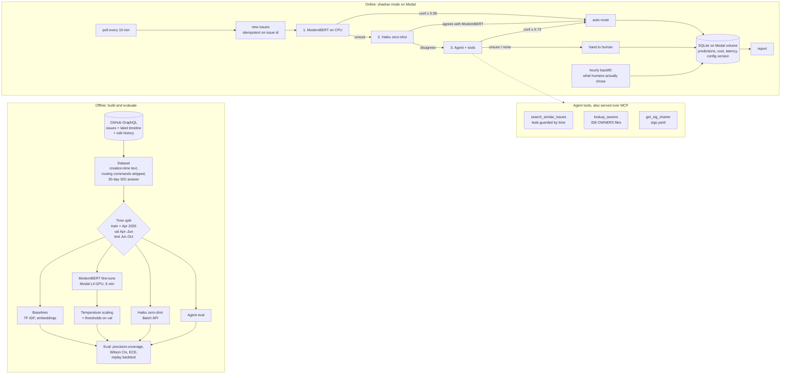

# k8s-issue-router

Routes every new [kubernetes/kubernetes](https://github.com/kubernetes/kubernetes) issue to the SIG
(Special Interest Group) that owns it, auto-assigning when confident and handing the rest to a human.
Evaluated offline on 3 years of history with a strict time split, and live in **shadow mode**:
it watches new issues, records what it would have done, and never touches the real repo.

## Why
About half of new k8s issues arrive without a SIG. Most authors add one within minutes, but when a
triager has to do it, it takes a **median 12 hours (p75: 91 hours)**. Routing is a classic
"send it to the right team" problem: cheap models handle the easy majority, expensive reasoning is
saved for the hard tail, and a human sees only what the system is unsure about.

## Results (test set: issues filed Jul–Sep 2026, after the LLM's knowledge cutoff)
Thresholds are chosen on the validation months and applied unchanged to test.

| Router | top-1 | auto-routed at a 95% precision target | precision achieved | cost / 1k issues |
|---|---|---|---|---|
| TF-IDF + logistic regression | 0.75 | 49.7% | 0.936 | ~$0 |
| Embedding kNN vote (bge-base) | 0.81 | 49.7% | 0.963 | ~$0 |
| Fine-tuned ModernBERT-base (calibrated) | 0.87 ± 0.01 (3 seeds) | 55–64% | 0.96–0.98 | ~$0 |
| Claude Haiku 5.5, zero-shot | 0.88 | 77.3% | 0.938 | $0.22 |
| **Cascade: ModernBERT → agreement → agent** | – | **76.0%** | **0.961** [0.93, 0.98] | ~$0.9 |
| Claude Sonnet 5.5, zero-shot (for comparison) | 0.91 | 80.0% | 0.955 | ~$15 |

- Sonnet alone does about as well as the whole cascade, at ~17x the live cost: the cascade buys cost, not accuracy.
- ModernBERT settles 19% of issues alone; 81% get one Haiku call; 26% also get the agent.
- On issues a human (not the author) had to route, the cascade (config v2) auto-routes 2 in 3, and gets 30 of 31 right.
- Strict view: counting every auto-routed issue that never got a SIG as an error, precision is 0.855.
  Most of those are issues nobody picked up or that were fixed without a label, so this is a floor, not the real error rate.
- Full tables, seed variance, contamination check and error analysis: [RESULTS.md](RESULTS.md).

## Architecture



**The cascade.** ModernBERT decides alone when it is very sure. Otherwise the zero-shot LLM is asked,
and agreement between two independent models is the signal: they agree on 83% of issues, and when
they do, the answer is right 94.6% of the time (45.8% when they disagree). The rest go to a tool-using
agent, which mostly decides *which* model to trust, and says "none" for support questions or issues
that belong elsewhere. LLM confidence is never used on its own: Haiku reports a handful of fixed values
(0.6 / 0.8 / 0.93), so it cannot be thresholded precisely.

**Shadow service.** One Modal app: a 10-minute cron poller, an hourly back-filler of human outcomes,
and a report. Every row stores the config version, so changing thresholds never mixes results.
Failures degrade instead of stopping: LLM error → ModernBERT-only for that issue; daily LLM budget
($1) exceeded → ModernBERT-only for the rest of the day.

## Evaluation choices
- **Creation-time inputs only.** Titles and bodies are restored to their original version (767 titles and
  2,170 bodies were edited later, often adding the component name). `/sig`, `/kind`, `/area` commands and
  `@kubernetes/sig-*` mentions are stripped.
- **Answer = SIG labels present 30 days after creation**, replayed from label/unlabel events.
- **Time split, not random**: the test months come after the training data and after the LLM's
  knowledge cutoff (no sign of contamination: Haiku scores 0.874 before vs 0.864 after).
- **Thresholds picked on val, applied to test**, with Wilson intervals; val→test drift costs ~1 point.
- **Replay backtest** pushes the test period through the shadow service's own decision code.

## Repository
| | |
|---|---|
| `fetch_issues.py`, `fetch_originals.py` | pull issues, timelines, original text (GraphQL, resumable) |
| `build_dataset.py`, `router/data.py` | cleaning, gold labels, routing source, time split |
| `router/eval.py` | precision-coverage, Wilson CI, ECE, val→test threshold transfer |
| `baselines_tfidf.py`, `baselines_emb.py` | B0 / B1 baselines |
| `modal_app.py`, `m2_eval.py` | GPU embedding + ModernBERT fine-tuning on Modal; calibration |
| `b2_zeroshot.py`, `router/llm.py` | Haiku zero-shot via Batch API, structured outputs |
| `agent.py`, `router/tools.py`, `router_mcp.py`, `agent_eval.py` | tool-using agent; tools served over MCP |
| `shadow.py`, `replay.py` | live shadow service; offline replay through the same decision code |
| `build_owners_map.py`, `build_ci_job_map.py` | OWNERS→SIG map; CI job→SIG map (tested, rejected: 45% agreement) |

## Reproduce
```bash
pip install -r requirements.txt
cp .env.example .env            # GITHUB_TOKEN, ANTHROPIC_API_KEY, MODAL_TOKEN_ID/SECRET
python fetch_issues.py --since 2023-10-01 --out data/raw/issues_3y.jsonl
python fetch_originals.py data/raw/issues_3y.jsonl data/raw/originals_3y.jsonl
# merge originals -> data/interim/issues_3y_orig.jsonl, then:
python build_dataset.py && python baselines_tfidf.py
bash run_modal.sh               # embeddings + ModernBERT on Modal
python b2_zeroshot.py submit && python b2_zeroshot.py collect --wait
python agent_eval.py run && python agent_eval.py score
python replay.py
modal deploy shadow.py          # shadow mode
```

## Limits
- Live traffic is ~1 issue/hour, so live numbers stay small; the replay backtest carries the main result.
- Validation set is small (356 labeled issues): coverage at a fixed precision moves 55–64% across seeds.
- Errors cluster in CI-failure issues and at SIG boundaries (DRA: node vs scheduling; Windows vs storage/node).
- Shadow mode only. No labels or comments are ever written to kubernetes/kubernetes.
